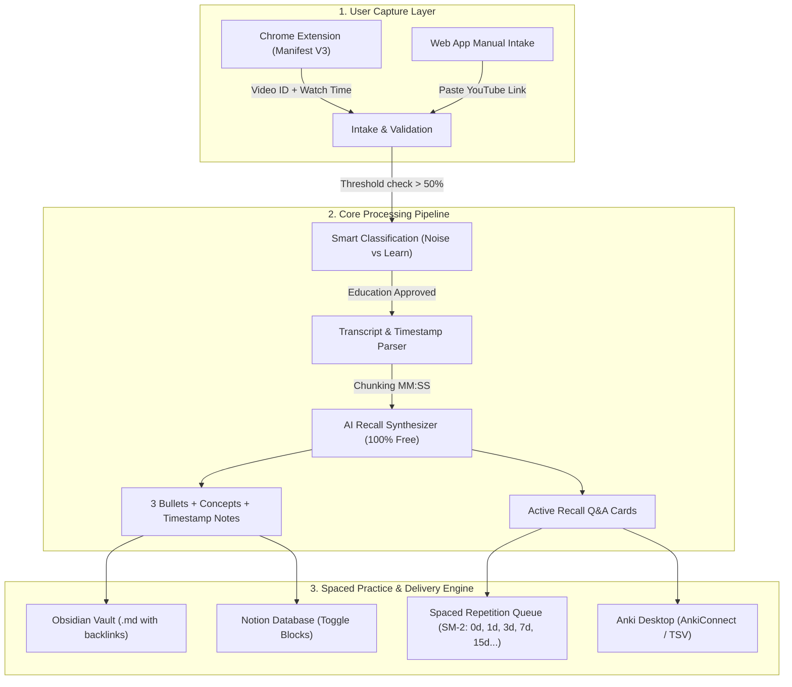

# 🧠 AI Micro-Learning & Spaced Repetition Ecosystem for YouTube

> Turn YouTube videos you watch into structured notes, timestamped breakdowns, and active recall flashcards — revised at scientifically proven spaced intervals so you actually retain what you learn.
>
> **100% Free Forever**: Operates out of the box with zero required paid subscriptions, zero credit card requirements, and local offline fallback heuristics.

---

## 📌 Problem & Solution

* **The Problem:** People watch many insightful, educational videos but forget up to 80% within 48 hours (the Ebbinghaus Forgetting Curve). Taking notes manually is tedious, and revisions rarely happen.
* **The Solution:** The ecosystem automatically captures watched videos, verifies educational value, extracts transcripts with timestamps, synthesizes 3-bullet takeaways, key concepts, and active recall flashcards, and organizes them into a **Spaced Repetition Schedule** (`Immediately -> 1d -> 3d -> 7d -> 15d -> 30d -> 60d -> 90d -> 180d`) with direct export to **Obsidian**, **Anki**, and **Notion**.

---

## 🏗️ System Architecture



---

## 💎 Why It Is 100% Free

| Component | How it runs for free |
| :--- | :--- |
| **Video Metadata & Transcripts** | Uses direct YouTube caption streams and oEmbed APIs. No paid YouTube Data API quota required. |
| **AI Recall Generation** | **Multi-tier zero-cost architecture**:<br>1. **Built-in Local NLP Synthesizer**: Runs 100% locally and offline without any API keys or network cost.<br>2. **Google Gemini Free Tier**: Compatible with free API keys from Google AI Studio (15 RPM free, no credit card).<br>3. **Groq Cloud Free Tier**: Compatible with free Groq Llama 3.3 keys.<br>4. **Ollama**: Connects directly to local models (`localhost:11434`) with zero external calls. |
| **Database & Storage** | Lightweight SQLite database with SQLAlchemy. Zero cloud costs, runs locally, complete user privacy. |
| **Note Routing** | Direct local filesystem export for Obsidian, local HTTP bridge for AnkiConnect, and standard free Notion integration. |

---

## 🚀 Quickstart Guide

### 1. Run Backend & Web Dashboard Locally

1. **Activate virtual environment:**
   ```bash
   # Windows
   .\venv\Scripts\activate

   # macOS / Linux
   source venv/bin/activate
   ```

2. **Start the server:**
   ```bash
   python backend/run.py
   ```
   Or:
   ```bash
   uvicorn backend.app.main:app --host 0.0.0.0 --port 8000
   ```

3. **Open the Web Dashboard:**
   Visit [http://localhost:8000](http://localhost:8000) in your browser.
   - Click **Add Video** to paste any educational YouTube link and watch it generate study notes instantly.
   - Click **Review Due** to practice active recall flashcards with the interactive card flip interface.

---

### 2. Install the Chrome Extension

1. Open Google Chrome (or Brave / Edge) and navigate to `chrome://extensions`.
2. Toggle on **Developer mode** in the top right corner.
3. Click **Load unpacked** and select the `c:\youtube recall solution\extension` folder.
4. Navigate to any YouTube video (e.g. 3Blue1Brown, Veritasium, freeCodeCamp):
   - You will see the injected **🧠 Save to Learn** button directly in the YouTube player.
   - Click the button to synthesize flashcards and send the video to your review queue!
   - Click the extension icon in the toolbar to see real-time watch progress and server connection status.

---

### 3. Note Apps Integration

#### 📓 Obsidian
- In the dashboard **Settings**, specify your Obsidian Vault path (e.g., `C:\Users\username\Documents\Vault\YouTube`).
- When viewing any video in the dashboard, click **Obsidian .md** to save it directly with frontmatter, tags `#micro-learning`, and clickable timestamp links.
- Or click the download icon on any card to download the `.md` file.

#### 📇 Anki
- **Option A (Instant TSV)**: Click **Anki TSV** to download a tab-separated file. In Anki Desktop, go to `File -> Import`, select the file, and all cards are imported with tags and deep links!
- **Option B (1-Click AnkiConnect)**: With the free AnkiConnect add-on (Code: `2055492159`) installed in Anki Desktop, click **Anki Sync** to auto-inject cards directly into your "YouTube Micro-Learning" deck.

#### 📝 Notion
- In **Settings**, paste your free Notion Internal Integration Token and Database ID.
- Click **Notion** on any video note to automatically create a database page with toggles for interactive active recall.

---

## 🧪 Testing & Verification

Run the test suite to verify all pipeline components:

```bash
# Run unit & pipeline tests
.\venv\Scripts\python tests\test_pipeline.py

# Run end-to-end API lifecycle tests
.\venv\Scripts\python tests\test_api_endpoints.py
```

---

## 📖 Spaced Repetition Schedule Details

Following the specification in the architecture design, flashcards advance along the retention curve:

| Milestone | Schedule Gap | Purpose |
| :--- | :--- | :--- |
| **Step 0** | Immediately (0 days) | Test initial retention right after watching. |
| **Step 1** | 1 day | Counter initial steep drop of forgetting curve. |
| **Step 2** | 3 days | Consolidate working memory into episodic memory. |
| **Step 3** | 7 days | First weekly review checkpoint. |
| **Step 4** | 15 days | Bi-weekly reinforcement. |
| **Step 5** | 30 days | Monthly retention milestone. |
| **Step 6** | 60 days | Long-term memory transfer. |
| **Step 7** | 90 days | Quarterly validation. |
| **Step 8** | 180 days | Permanent mastery milestone. |
